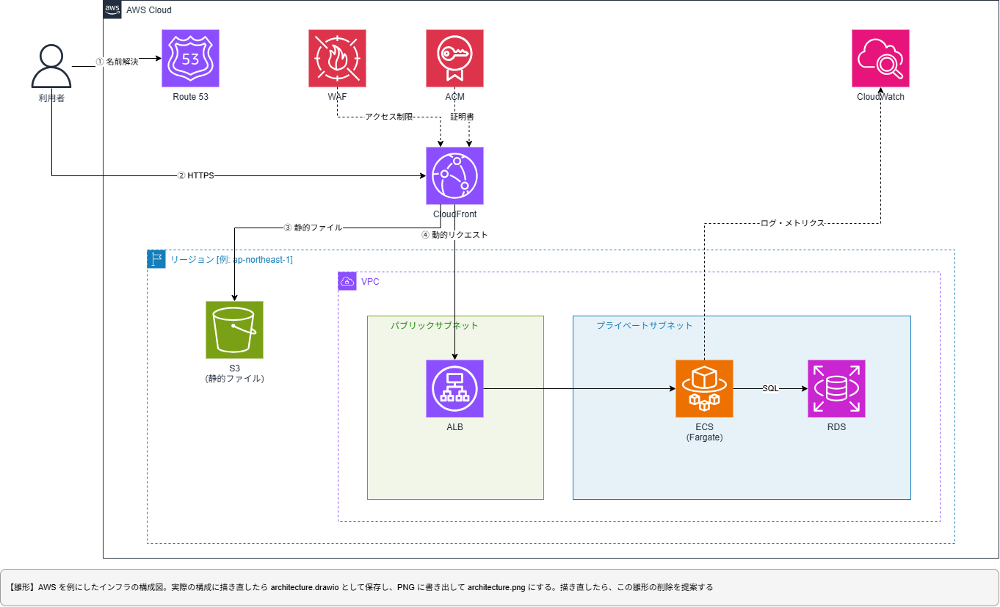

# アーキテクチャ概要

<!--
これは雛形。実物は、同じフォルダの architecture.md。
実物を作る手順と、作った後に雛形の削除を提案することは、docs/README.md の「雛形から実物を作るとき」に従う。
構成図は、architecture.template.drawio を複製した architecture.drawio を draw.io で描き、PNG に書き出して architecture.png にする。実物では、下の画像のリンクを architecture.png に直す。
実物には、`[例: ...]` と、このコメントを残さない。実物ができると、CLAUDE.md の「参照ドキュメント」の `@docs/architecture/architecture.md` から自動で読み込まれる。
-->

[例: 静的ファイルを CDN から配信し、動的な処理だけをアプリケーションサーバーで受ける構成]

## 構成図

構成図のソースは、同じフォルダの draw.io のファイル。採用した理由は、ADR（`docs/adr/`）に書き、ここには書かない。

## 構成要素

| レイヤー | サービス |
| --- | --- |
| DNS | [例: Amazon Route 53] |
| CDN | [例: Amazon CloudFront] |
| HTTPS 証明書 | [例: AWS Certificate Manager（us-east-1）] |
| 静的ファイル | [例: Amazon S3] |
| アプリケーション | [例: Application Load Balancer + ECS（Fargate）] |
| データベース | [例: Amazon RDS] |
| 秘匿情報 | [例: AWS Secrets Manager] |
| 監視・通知 | [例: Amazon CloudWatch。異常は SNS でメールに通知する] |
| CI/CD | [例: GitHub Actions] |

## 環境ごとの違い

| 項目 | 本番 | 検証（STG） |
| --- | --- | --- |
| [例: インスタンスのサイズ] | [例: 大] | [例: 小] |
| [例: WAF] | [例: あり] | [例: なし] |
| [例: アクセス制限] | [例: 一般公開] | [例: Basic 認証] |

## リクエストの経路

| パス | 振り分け先 | 用途 |
| --- | --- | --- |
| [例: `/` ほか公開ページ] | [例: S3] | [例: 静的な HTML・画像] |
| [例: `/api/*`] | [例: ALB → ECS] | [例: アプリケーションの API] |
| [例: 存在しないパス] | [例: CDN のエラーページ] | [例: 404 ページの表示] |

## デプロイの経路

- [例: main へのマージで、GitHub Actions がビルドして S3 へ配置し、CDN のキャッシュを無効化する]
- [例: インフラは Terraform で管理し、開発者の端末から実行する]
